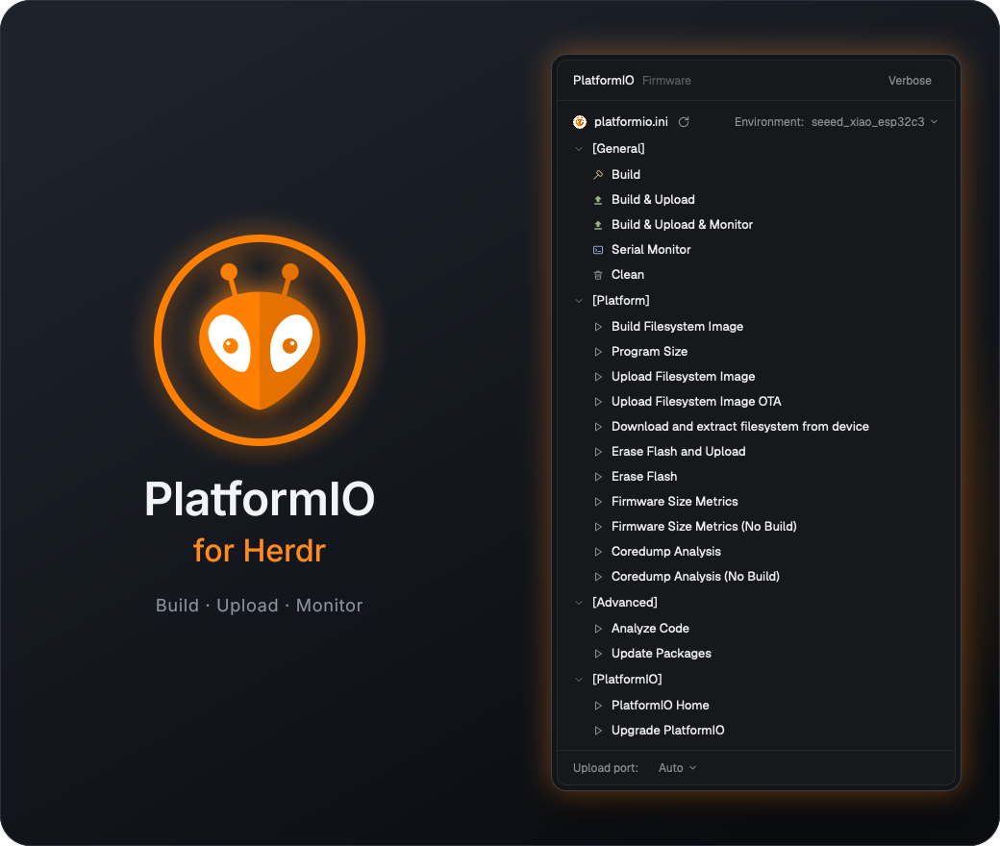

# herdr-platformio



Build, upload and monitor your PlatformIO project without leaving [herdr](https://herdr.dev). A view lists every
task of the active environment and runs it in a herdr terminal with one click; `platformio.ini` opens in an editor
right there.

Requires PlatformIO Core (`pio`). Works on Windows, macOS and Linux.

## Install

Ask your herdr agent to add the mod from this repo's `mods/platformio` folder, or copy it yourself:

```sh
cp -r mods/platformio ~/.config/herdr-app/mods/platformio
herdr-app check ~/.config/herdr-app/mods/platformio
```

herdr reloads mods on its own; no restart is needed.

**Recommended:** a "PlatformIO" button next to Files and Changes that opens the mod as a side panel.
A mod can't add that button itself, so it takes a small change to your layout; your agent makes it
once you agree (steps in [`RECIPE.md`](RECIPE.md#recommended-install)). herdr's built-in `main` layout is
read-only, so the agent clones it first, and the clone no longer receives herdr's updates to `main`.

## Or open it as a tab

Without the layout change, run the command `tab.new` with the mod `platformio` from the command palette
(Cmd+Shift+P), or from a shell:

```sh
herdr-app do tab.new --mod platformio --name PlatformIO
```

## Usage

- **Project:** the folder of the focused terminal pane, else the current space's folder, when it holds a
  `platformio.ini` itself; parent and sub folders are not searched. Opened as a tab, the mod has the focus
  itself, so it uses the space's folder.
- **Keys:** the commands `platformio.ini` (open or close the editor) and `platformio.save` can be bound in `keys.json`.

## What it runs and touches

- Programs: `pio` (else `platformio`, else `~/.platformio/penv/bin/pio`, the installer's default place) for
  everything PlatformIO does, and a small wrapper that names a task's terminal and keeps it open until Enter: `/bin/sh` (waiting with `head`) on macOS and Linux, Windows PowerShell on Windows.
- Without a click: `pio --version` once, to find `pio`. When the folder holds a `platformio.ini`, also
  `pio project config` and `pio project metadata -e <env>` (slow: often 15 to 45 seconds, longer when it first
  downloads a platform; it gives up after 5 minutes). Both run again only when `platformio.ini` changes or
  the reload icon is clicked; the targets are cached per environment. A timer checks every 10 seconds whether
  the folder or file changed. `pio device list` runs each time the port dropdown opens. Everything else runs
  only when you click a task.
- Files: it reads `platformio.ini` and the `extra_scripts` files named in it, and writes `platformio.ini` only when you press Save.
- Network: the mod makes no requests of its own, but `pio` does: Update Packages, Upgrade PlatformIO and
  PlatformIO Home go online, and `pio project metadata` may download a missing platform or toolchain the first time.
- State: small caches (targets, chosen environment, port, Verbose) in the mod's `localStorage`. The tab bar button
  adds `platformio` to herdr's shared `workspace.panels` list, so the tab bar remembers the panel per space.
- Remote spaces: in a space on another machine, `pio` (which must be on that machine's PATH) runs and
  `platformio.ini` is read there; saving the file works on this computer only.

## Notes

- `mods/platformio/logo.svg` is the PlatformIO logo by PlatformIO, licensed under the Apache License 2.0
  (<https://www.apache.org/licenses/LICENSE-2.0>), taken from
  <https://de.wikipedia.org/wiki/Datei:PlatformIO_logo.svg>. The logo is a trademark of PlatformIO. The MIT license of this repository does not cover the logo.
- The `platformio.ini` editor has no syntax colours: herdr has no INI grammar.
