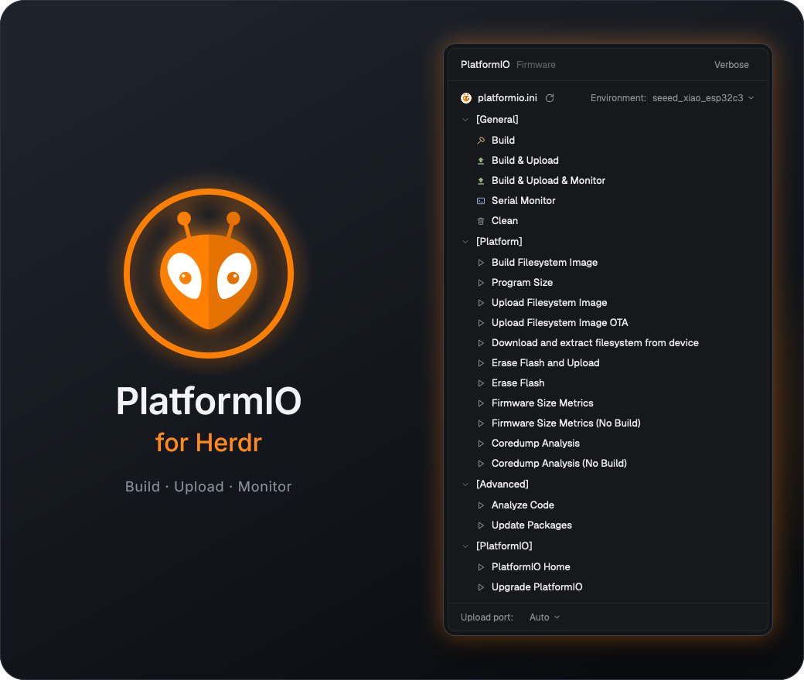

# PlatformIO

PlatformIO in herdr: the tasks of the active environment, PlatformIO's own tasks, and an editor for `platformio.ini`. A click on a task runs `pio` in a herdr terminal.



## What you see

A side panel on the right, shown and hidden by a "PlatformIO" button (logo and label) in the tab bar, next to herdr's Files and Changes buttons. It shares the right-hand panel with Files and Changes (see "Recommended install"). Without that layout change it can be opened as a tab instead (`tab.new {mod: "platformio"}`). Top to bottom:

- **Header, 42px:** the title "PlatformIO" and the project folder's name (dimmed, truncated), then the "Verbose" toggle. While `platformio.ini` is open the header shows a back arrow, "platformio.ini", a "●" when there are unsaved changes, and a "Save" button.
- **Tree, scrolling:** first the `platformio.ini` row (a click opens the editor), a reload icon right next to it, and on the right "Environment: <env>", a dropdown to switch environments (a plain label when there is only one; when the row is too narrow its start is clipped, so the end of the name and the arrow stay visible). Then groups with their titles in square brackets, each foldable (open by default, with chevrons):
  - `[General]`: Build, Build & Upload, Build & Upload & Monitor, Serial Monitor, Clean.
  - `[Extra Scripts]`: the targets the active environment's own `extra_scripts` add.
  - `[Platform]`: every other target of the environment, in the order `pio` reports them (platform targets, then the platform package's `Custom` targets).
  - `[Advanced]`: Analyze Code, Update Packages.
  - `[PlatformIO]`: PlatformIO Home, Upgrade PlatformIO.
  - `[Extra Scripts]` and `[Platform]` show only when they have entries.
- **Footer, 36px:** "Upload port:" and a dropdown of the connected serial ports (`Auto` by default), read with `pio device list` each time it opens.
- Each task has a 12px icon in the theme's `muted` color: a triangle by default, a hammer (`ansi3`) for Build, an upload arrow (`ansi2`) for Build & Upload and Build & Upload & Monitor, a terminal (`ansi4`) for Serial Monitor, a trash can (`muted`, like the default) for Clean. The PlatformIO logo sits in the `platformio.ini` row.

## How it behaves

- **Project:** the focused terminal pane's folder (else the space's folder; in its own tab the mod has the focus, so it uses the space's folder), and only that folder: it counts as a project when it holds a `platformio.ini` itself. There is no search up or down. Without one the view says "No platformio.ini in this folder".
- **Environment:** the saved one, else `default_envs`, else the first. The choice, the port and "Verbose" are remembered per project.
- **Targets:** from `pio project metadata -e <env> --json-output`, which can take 15 to 45 seconds. The result is kept per project and environment (in `localStorage`) and fetched again only when `platformio.ini` changes or the reload icon is clicked. A timer checks every 10 seconds whether the folder or file changed.
- **Run a task:** a click opens a terminal under the focused pane (a new tab when no pane has focus) and runs the command; the task's icon turns the `working` color while its terminal is open (only tasks with the default triangle; tasks with their own icon keep their color). A new task closes the previous output terminal; a monitor stays open until a task needs the serial port. The terminal stays after the program ends until Enter is pressed.
- **Commands:** targets run `pio run -e <env> -t <target>`; Build `pio run -e <env>`; Build & Upload `-t upload`; Build & Upload & Monitor `-t upload -t monitor`; Clean `-t clean`; Serial Monitor `pio device monitor -e <env>`; Analyze Code `pio check -e <env>`; Update Packages `pio pkg update -e <env>`; Home `pio home`; Upgrade PlatformIO `pio upgrade`. A tooltip on each task shows its full command (`pio …` with the current flags). "Verbose" adds `-v`, a chosen port adds `--upload-port <port>` (Build & Upload & Monitor also `--monitor-port <port>`, Serial Monitor `--port <port>`).
- **Editor:** a click on the `platformio.ini` row opens the file in herdr's `Editor` (editable, line numbers, no syntax colours). "Save" writes the file with `writeTextFile(path, text, expected)`, which fails when the file changed on disk meanwhile, then reloads the targets. If the file changes on disk while there are unsaved edits, nothing is overwritten: the header says "platformio.ini changed on disk" and shows "Reload" (discards the edits). The back arrow asks once ("click ← again to discard") when there are unsaved changes. Saving works on this computer only.
- Groups fold and unfold by click.
- **Port list:** if `pio device list` fails, its error shows in the port menu instead of "No devices found".

## Built from

- One file, `mods/platformio/main.js`, a `View` class with two `props` roles: none is the panel itself, `{ "button": true }` is the tab bar button (it toggles `panel` and selects the `platformio` child of `panel-body`, and adds `"platformio"` to shared `"workspace.panels"` so the tabs mod restores it per space). `mod.json` is `{ "place": "none", "title": "PlatformIO" }`.
- `herdr`: `spaces`, `panes`, `focused`, `terminals`, `exec`, `readTextFile`, `writeTextFile`, `run` (`terminal.open`, `terminal.kill`), `theme`, `settings`, `nextCommand`, `checking`; `gpui-base`: `Editor`, `EditorState`, `Popover`. Caches and preferences live in `localStorage`.
- Icons in the folder: `logo.svg` (the PlatformIO logo), `task.svg`, `hammer.svg`, `upload.svg`, `terminal.svg`, `trash.svg`, `refresh.svg`, `chevron-down.svg`, `chevron-right.svg`. `svg()` tints the whole icon in one color. Task icons use 2px strokes with round caps and joins, rounded corners a 2.5 radius; only the upload icon has a filled arrow and a 3px bar.
- Programs it runs: `pio` and `/bin/sh` (the terminal wrapper only; see README).

## Recommended install

1. Copy `mods/platformio/` to `~/.config/herdr-app/mods/platformio/` and run `herdr-app check` on it. This alone changes nothing on screen: `"place": "none"` docks nothing.
2. **Ask the person first:** "Add a PlatformIO button next to Files and Changes? This changes your layout." Without a yes, stop here and point to the tab route (`herdr-app do tab.new --mod platformio --name PlatformIO`).
3. Find the shown layout: `herdr-app status` prints it as `"layout"`; the file is `layouts/<name>.json`. herdr's own layouts (`main`, `terminals`, `win98`) are read-only and restored on every start, so never edit them. If the person uses `main`, run `herdr-app do layout.clone '{"name":"main","as":"main-copy"}'` (pick a free name; it switches to the clone) and tell them the clone no longer receives herdr's updates to `main`. A layout that is already the person's own (a clone) is edited in place.
4. In that layout, change two nodes and nothing else:
   - **Tab bar:** replace the block `{ "id": "tabs", ..., "size": { "px": 42 }, "window_drag": true, "content": { "mod": "tabs" } }` with a row that holds it and the button:
     ```json
     { "id": "tabs-row", "type": "row", "size": { "px": 42 }, "resizable": false, "children": [
       { "id": "tabs", "type": "block", "window_drag": true, "content": { "mod": "tabs" } },
       { "id": "platformio-button", "type": "block", "size": { "px": 112 }, "content": { "mod": "platformio", "props": { "button": true } } }
     ] }
     ```
   - **Panel:** append `{ "id": "platformio", "type": "block", "content": { "mod": "platformio" } }` to the children of the stack `panel-body` (after `files` and `changes`).
5. Keep the file's other keys and order, and run `herdr-app status` to check for errors. If the layout has no `tabs` block or no `panel-body` stack, it is not built like `main`: do not guess, use the tab route.

## Watch out

- `pio project metadata` is slow: it loads the environment's whole build configuration (no compiling). Do not start it for an environment you do not want to touch; changing the cache key or `platformio.ini` starts it again for the saved environment.
- herdr has no INI grammar: `ini` and `toml` are unknown languages (no colours), `yaml` colours the whole file green and `properties` colours it wrongly. Leave the editor without colours.
- Terminals are recognised by their `argv`; the `sh -c` wrapper is `argv[2]` and the task name `argv[3]`.
- An icon cached by herdr keeps its first image per path: restart herdr after replacing one.
- macOS and Linux only; `/bin/sh` is required.

## Done when

- `herdr-app check ~/.config/herdr-app/mods/platformio` passes and `herdr-app status` shows no errors.
- With the recommended install, the tab bar shows a "PlatformIO" button right of Changes; clicking it opens the panel on the right, clicking again hides it.
- In a space whose folder holds a `platformio.ini`, the tab shows the tree with `[General]` and `[PlatformIO]`.
- Clicking Build runs `pio run -e <env>` in a terminal under the pane and the terminal stays until Enter.
- Opening `platformio.ini`, changing a line and pressing Save writes the file, and the "●" disappears.
- Changing the file on disk while there are unsaved edits shows "platformio.ini changed on disk" and does not overwrite the edits.
